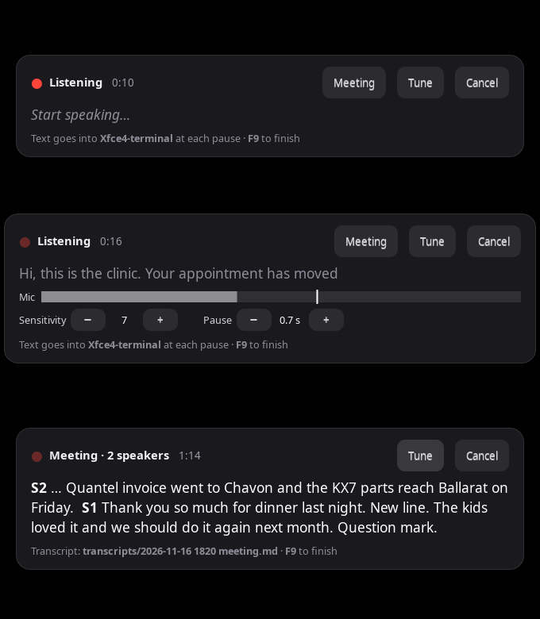
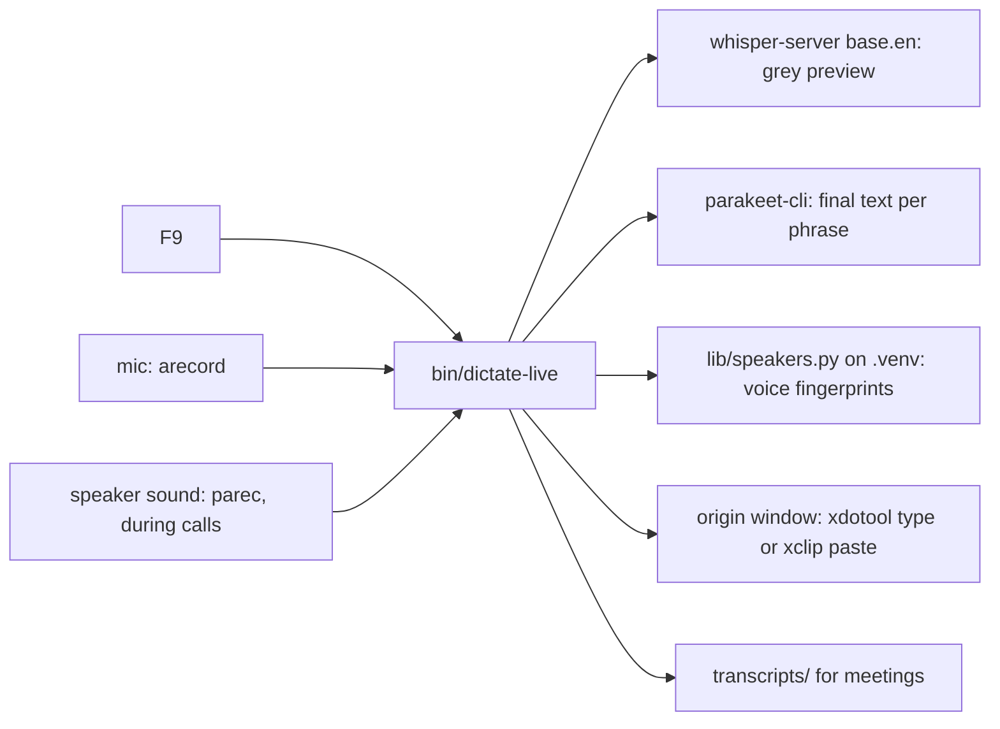

# OnDevice Speech To Text

**Press F9 and talk: your words are typed into the window you started in as you pause, and conversations turn into speaker-labelled meeting transcripts. Nothing leaves the laptop.**

`status: in production` · `platform: Linux X11 (XFCE)` · `runs: fully offline` · `engines: Parakeet TDT 0.6b v3, Whisper` · `licence: AGPL-3.0 + commercial`

Last updated: 2026-11-16T14:13:43+00:00. In daily use on the reference machine, a Dell Inspiron 15 5510 (Linux Mint 22.1, XFCE 4.18, X11) since 2026-10-20T13:37:45+00:00.



## Contents

- [Overview](#overview)
- [Features](#features)
- [Using it](#using-it)
- [Architecture](#architecture)
- [Tech stack](#tech-stack)
- [Installation](#installation)
- [Configuration](#configuration)
- [Commands](#commands)
- [Project structure](#project-structure)
- [Testing](#testing)
- [Deployment and rollback](#deployment-and-rollback)
- [Known limitations](#known-limitations)
- [Troubleshooting](#troubleshooting)
- [Roadmap](#roadmap)
- [Documentation](#documentation)
- [Working on this project](#working-on-this-project)
- [Licence](#licence)
- [Acknowledgements](#acknowledgements)

## Overview

Linux has no built-in dictation that types into any app. This project adds it for one laptop: a global F9 key, a small floating box, and local speech models on the laptop's GPU. It is built for someone who moves between windows while thinking and talking, so text always goes back to the window where F9 was pressed, and for calls and in-person conversations, which become transcripts with speaker labels.

Everything runs on the machine: whisper.cpp for speech to text, sherpa-onnx for voice fingerprints, GTK for the box. No audio or text is sent anywhere.

## Features

- **Text as you talk.** Each time you pause (0.7 s), that phrase is transcribed by the accurate engine and typed in, about 1 to 2 s later on an idle laptop.
- **Always the right window.** Text goes only to the window where you pressed F9. While you work in other windows, phrases wait and go in when you return; nothing ever takes your keyboard.
- **Live preview.** The phrase you are saying shows in grey in the box; finished phrases in white.
- **Meetings, automatically or with one click.** When a second voice speaks for 20 s, or when you click **Meeting**, the session becomes a meeting: text goes to `transcripts/<date time> meeting.md` with timestamps and Speaker 1, 2, 3 labels, corrected over the whole meeting at the end.
- **Online calls.** While a call is open, the computer's sound is transcribed too; your mic hearing the call through the speakers is recognised and not duplicated.
- **Tune in the box.** A level bar with the speech line, Sensitivity and Pause controls, saved for next time.
- **No length limit.** Talk for an hour; the session ends after 10 minutes of silence or 4 hours.
- **Nothing lost.** Every phrase is written to a private file as it arrives; the last 20 sessions' text is kept.
- **Your numbers, not your words.** `dictate-stats` shows how, when and where you dictate, without storing what you said in the log.

## Using it

**Table U1: Everyday use**

| Action | How |
|---|---|
| Start | Press **F9**. A sound plays and the box shows "Listening" |
| Dictate | Talk. Each phrase is inserted when you pause |
| Work elsewhere meanwhile | Switch windows freely. The box shows "N phrases waiting"; they go in about 0.5 s after you return to the original window |
| Finish | Press **F9** again, from any window. The last phrase goes into the original window (focused for a moment, then you are returned to where you were) |
| Discard | Click **Cancel**: text already inserted stays, the rest is dropped (still in `data/dictations.txt`) |
| Start a meeting now | Click **Meeting**. Or just let it switch when a second voice speaks for 20 s |
| End a meeting | Press **F9**. The transcript is saved in `transcripts/`, a notification shows, and its path is on the clipboard |
| Tune | Click **Tune**: raise **Sensitivity** if soft speech is missed, lower it if phrases never end; adjust **Pause** to your speaking rhythm |
| Move the box | Drag it; the position is remembered |
| Find lost text | Clipboard, then `data/live/` (a crashed session), then `data/dictations.txt`, then `transcripts/` |

The box never takes keyboard focus; clicking its buttons is safe while dictating. In terminals, text of 100 characters or more is pasted rather than typed, and your clipboard is restored. Tell people when a conversation is being transcribed.

## Architecture



One Python process per session (`bin/dictate-live`, system Python with GTK). A reader thread per audio stream measures loudness and cuts phrases at pauses; a preview thread shows the current phrase; a transcribe thread runs each finished phrase through Parakeet and the speaker helper in order; the GTK thread inserts text, holds it while you are elsewhere, writes files and draws the box. The second F9 press is a second process that signals the first. Full design: [docs/ARCHITECTURE.md](docs/ARCHITECTURE.md).

## Tech stack

**Table U2: Stack**

| Layer | Technology |
|---|---|
| Speech to text | whisper.cpp 1.9.5 (Homebrew) with ggml Vulkan; NVIDIA Parakeet TDT 0.6b v3 (final), OpenAI Whisper base.en (preview), Whisper large-v3-turbo (alternative final), Silero VAD |
| Speaker labels | sherpa-onnx 2.0.1 with NeMo TitaNet small, numpy, in a `uv` venv |
| App | Python 3.12 (system `/usr/bin/python3`) with GTK 3 via PyGObject; standard library only |
| Desktop integration | XFCE shortcut, `xdotool`, `xclip`, `xprop`, `notify-send` |
| Audio | `arecord` (ALSA), `parec` and `pactl` (PulseAudio/PipeWire), `paplay` |
| Basic mode, installer | Bash |

## Installation

Requirements: Debian/Ubuntu-family Linux on **X11**, Homebrew at `/home/linuxbrew/.linuxbrew`, `uv`, a microphone, about 2 GB of disk. A Vulkan GPU is optional.

```bash
git clone https://github.com/PalWorks/ondevice-speech-to-text.git ~/Documents/"OnDevice Speech To Text"
cd ~/Documents/"OnDevice Speech To Text"
./install.sh            # apt packages, whisper.cpp, models (checksummed), .venv, links, F9 binding
./install.sh --check    # every line should be [ok]
```

Then press F9 in any text field, speak, pause, and press F9 again. Step-by-step manual install and porting notes: [docs/REPLICATE.md](docs/REPLICATE.md).

## Configuration

All settings are in `config/dictate.conf`, commented, re-read on every F9 press. Sensitivity and Pause can also be changed from the box.

**Table U3: Settings**

| Setting | Default | Meaning |
|---|---|---|
| `preview_model` | `ggml-base.en.bin` | Model for the grey preview |
| `final_engine` | `parakeet` | `parakeet` (English and European languages, fast) or `whisper` (Indian languages, vocabulary prompt, slower) |
| `parakeet_model`, `final_model` | Parakeet q8_0, large-v3-turbo q5_0 | Final models for each engine |
| `final_beam_size` | `5` | Beam width for whisper finals |
| `prompt` | names and terms | Vocabulary hint (whisper only) |
| `vad_model` | Silero v5.1.2 | Voice activity detection for whisper |
| `language` | `en` | `en`, a whisper language code, or `auto` (needs multilingual models) |
| `threads` | `4` | CPU threads for the engines |
| `pause_ms` | `700` | Pause that ends a phrase (box: Pause) |
| `speech_ratio` | `2.5` | Speech line as a multiple of the background (box: Sensitivity 1 to 10) |
| `speech_min_rms` | `200` | Absolute floor for the speech line |
| `max_phrase_seconds` | `25` | Longer phrases are cut at their quietest moment |
| `silence_stop_seconds` | `600` | End the session after this long without speech |
| `max_seconds` | `14400` | Safety limit (4 hours) |
| `terminal_paste_min_chars` | `100` | In terminals, paste text this long instead of typing it |
| `backup_text`, `backup_keep` | `true`, `20` | Keep session text in `data/dictations.txt` |
| `meetings` | `true` | Speaker labels and meeting mode |
| `meeting_min_seconds` | `20` | Second-voice speech needed for the automatic switch |
| `call_audio` | `true` | Record the computer's sound while a call is open |
| `log_sessions`, `log_text` | `true`, `false` | Session numbers in `data/sessions.jsonl`; never the words unless `log_text` |
| `sounds` | `true` | Start and stop sounds |
| `hotkey_label` | `F9` | Key name shown in the box |

## Commands

```bash
dictate-stats              # your patterns: outcomes, speed, apps, hours, trend (all time)
dictate-stats --days 7     # last week only; add --json for machine-readable output
dictate-compare            # record once, see every engine's transcript and speed side by side
dictate-compare file.wav   # the same for an existing 16 kHz mono WAV
dictate                    # basic mode: same engine, one pass at the end, no box
./install.sh --check       # verify the whole setup (from this folder)
```

**Table U4: Switching modes and engines**

| Goal | Change |
|---|---|
| Basic mode on F9 | `xfconf-query -c xfce4-keyboard-shortcuts -p /commands/custom/F9 -s "$HOME/.local/bin/dictate"` |
| Back to live mode | The same command with `dictate-live` |
| Whisper instead of Parakeet | `final_engine = whisper` |
| Tamil, Hindi and other Indian languages | `final_engine = whisper`, `language = ta` (or `hi`, `auto`), and a multilingual `preview_model` |
| Names and jargon | Add them to `prompt` (whisper only) |

## Project structure

**Table U5: Layout**

| Path | Contents |
|---|---|
| `bin/dictate-live` | Live mode, bound to F9: phrases, insertion, meetings, box (Python + GTK) |
| `bin/dictate` | Basic mode (Bash), a lightweight fallback |
| `bin/dictate-stats` | Analytics report over `data/sessions.jsonl` |
| `bin/dictate-compare` | One clip through every engine |
| `lib/speakers.py` | Speaker helper (runs on `.venv`) |
| `lib/active-app`, `lib/log_session.py` | App name and session logging for basic mode |
| `config/dictate.conf` | All settings, commented |
| `install.sh` | Install and `--check` self-test |
| `LICENSE`, `COMMERCIAL-LICENSE.md` | AGPL 3.0 text; how to get a commercial licence |
| `models/` | Speech and speaker models, 1.9 GB (downloaded by `install.sh`) |
| `.venv/` | Python venv for sherpa-onnx (created by `install.sh`) |
| `data/` | `sessions.jsonl` (numbers), `dictations.txt` and `live/` (private text), `overlay-position.json` |
| `transcripts/` | Meeting transcripts (private) |
| `docs/` | Design, decisions, testing, runbook, security, domain, analytics, analysis, audit, replicate |

System links into the folder: `~/.local/bin/dictate`, `dictate-live`, `dictate-stats`, `dictate-compare` → `bin/`; `~/.local/share/whisper-cpp/models` → `models/`; XFCE `/commands/custom/F9` → `~/.local/bin/dictate-live`. Scripts resolve the project through `realpath`, so the folder can move.

## Testing

Changes are tested on a private hidden display (Xvfb with xfwm4) using a scratch copy of the code, the real engines, and recorded clips played as if from the mic, so the owner's screen, data and F9 session are never touched. Eight scenarios cover dictation with window switches, noise, silence and cancel, in-room and online meetings with echo, a long monologue, the Meeting button and the Tune panel. Procedure: [docs/TESTING.md](docs/TESTING.md). Static checks before every change:

```bash
/usr/bin/python3 -m py_compile bin/dictate-live && uvx pyflakes bin/dictate-live lib/speakers.py && ./install.sh --check
```

## Deployment and rollback

There is no build or CI: the F9 binding runs `bin/dictate-live` from this folder, so a saved edit is live on the next press. Deploy by editing, testing (above) and running `./install.sh --check`. Roll back with git (`git revert`, or `git checkout <sha> -- bin/dictate-live`), or switch F9 to basic mode as a stopgap ([docs/RUNBOOK.md](docs/RUNBOOK.md)). To set up another laptop: [docs/REPLICATE.md](docs/REPLICATE.md).

## Known limitations

- X11 only (`xdotool`); Wayland is not supported.
- English and European languages by default; Indian languages need `final_engine = whisper`, which is slower.
- Speaker labels are per phrase: two people speaking within one phrase share a label (ROADMAP row 19).
- The automatic meeting switch types the other person's first 20 s into your window; click **Meeting** to avoid it.
- Meeting detection, echo handling and pause detection were tuned on test clips, not yet on real calls (ROADMAP row 16).
- `xdotool type` can mistype some non-ASCII characters in a few apps (row 21).
- Phrase latency rises with CPU load (about 6 s seen at load average 11).

## Troubleshooting

**Table U6: Quick fixes**

| Symptom | Fix |
|---|---|
| F9 does nothing | Try Fn+F9 or toggle Fn Lock; `./install.sh --check` |
| Text appears only at the end | Pauses not detected: **Tune**, lower Sensitivity |
| Soft words missed | **Tune**, raise Sensitivity |
| Box stuck | `pkill -f dictate-live; pkill -x whisper-server; pkill -f speakers.py` |
| Text went nowhere | It is on the clipboard and in `data/dictations.txt` |

More: [docs/RUNBOOK.md](docs/RUNBOOK.md).

## Roadmap

Open items, decisions and everything shipped: [ROADMAP.md](ROADMAP.md). Next: validate meetings and pause detection on a real call (row 16), commit the test harness (row 18).

## Documentation

**Table U7: Where to read what**

| Document | Read it for |
|---|---|
| [AGENTS.md](AGENTS.md) | Rules for AI agents changing this project (`CLAUDE.md` points to it) |
| [ROADMAP.md](ROADMAP.md) | What is open, decided, deferred and done |
| [CHANGELOG.md](CHANGELOG.md) | Every change, timestamped, newest first |
| [docs/ARCHITECTURE.md](docs/ARCHITECTURE.md) | Components, threads, flow, files, dependencies, limits |
| [docs/DOMAIN.md](docs/DOMAIN.md) | Exact meaning of phrase, origin window, held phrase, meeting, echo, outcomes |
| [docs/DECISIONS.md](docs/DECISIONS.md) | Why things are the way they are (D-01 to D-15) |
| [docs/TESTING.md](docs/TESTING.md) | How to test without touching the desktop |
| [docs/RUNBOOK.md](docs/RUNBOOK.md) | Symptoms, causes, recovery |
| [docs/SECURITY.md](docs/SECURITY.md) | What is stored, where, and who can read it |
| [docs/ANALYTICS.md](docs/ANALYTICS.md) | Every log field and how to read `dictate-stats` |
| [docs/ANALYSIS.md](docs/ANALYSIS.md) | Engine benchmarks and the options considered (2026-10-20) |
| [docs/AUDIT.md](docs/AUDIT.md) | Pre-production audit findings and fixes (2026-10-20) |
| [docs/REPLICATE.md](docs/REPLICATE.md) | Rebuild on another laptop |

## Working on this project

Issues are welcome: bugs, results on other hardware or desktops, and ideas. Because the project is dual-licensed (below), code contributions can only be merged if the contributor agrees that their contribution may be distributed under both the AGPL 3.0 and the commercial licence; say so in the pull request, or open an issue first.

AI agents working on this repository follow [AGENTS.md](AGENTS.md): back up before editing, test on the hidden display, never touch the user's windows or private files, run `./install.sh --check`, and update the CHANGELOG, DECISIONS, ROADMAP and affected docs in the same change. Changes to the box's design or key bindings need the maintainer's approval of a preview.

## Licence

Dual-licensed:

- **GNU Affero General Public License v3.0** ([LICENSE](LICENSE)). You may use, modify and share this software under the AGPL 3.0, including its requirement to offer the source of modified versions to users who interact with them over a network.
- **Commercial licence** for use without the AGPL obligations, for example inside a proprietary product. See [COMMERCIAL-LICENSE.md](COMMERCIAL-LICENSE.md).

Source files carry `SPDX-License-Identifier: AGPL-3.0-only`.

The speech and speaker models are not part of this repository; `install.sh` downloads them from their publishers, and each keeps its own licence: Parakeet TDT 0.6b v3 is CC-BY-4.0 (NVIDIA; GGUF conversion by ggml-org, MIT), the Whisper models and Silero VAD are MIT. TitaNet small is an NVIDIA NeMo model distributed through the sherpa-onnx releases; check its licence there before redistributing it (NVIDIA publishes TitaNet large under CC-BY-4.0; the small model's licence was not verified here).

## Acknowledgements

- [whisper.cpp](https://github.com/ggml-org/whisper.cpp) and ggml, for local Whisper and Parakeet inference with Vulkan.
- NVIDIA Parakeet TDT 0.6b v3 (GGUF conversion by ggml-org) and OpenAI Whisper models.
- [sherpa-onnx](https://github.com/k2-fsa/sherpa-onnx) and the NeMo TitaNet small speaker model.
- Silero VAD.
