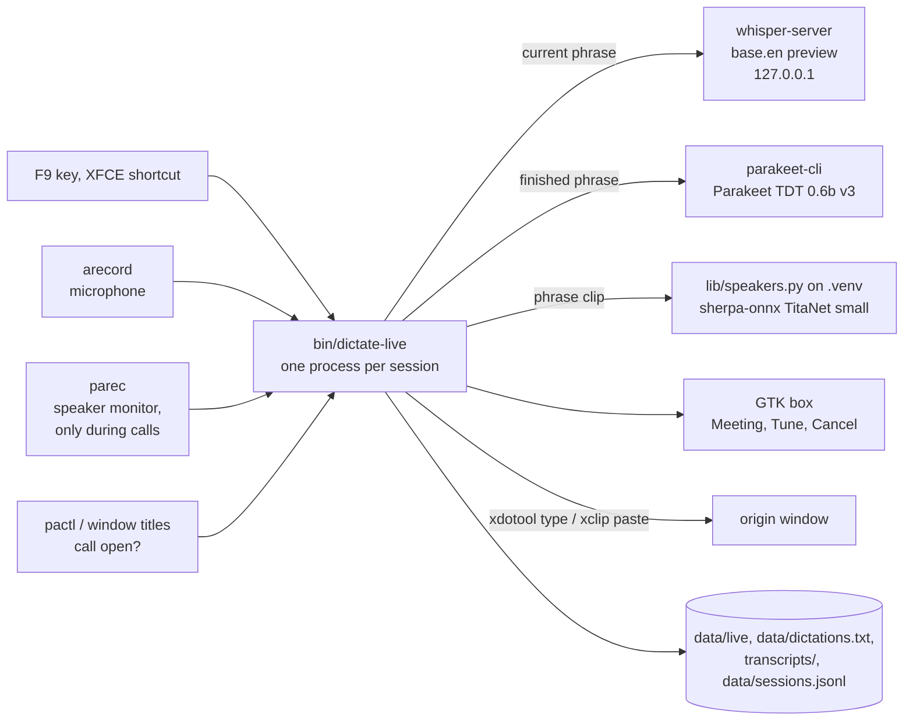

# Architecture

Last updated: 2026-11-16T12:52:17+00:00

How the system is built. Words used here are defined in [DOMAIN.md](DOMAIN.md); the reasons behind each choice are in [DECISIONS.md](DECISIONS.md).

## Component diagram



## Components

**Table A1: Components**

| Piece | What it is |
|---|---|
| Hotkey | XFCE custom shortcut F9 runs `~/.local/bin/dictate-live` (symlink into `bin/`). A second press runs a second process that signals the first |
| Mic capture | `arecord`, 16 kHz mono 16-bit, default ALSA device (PipeWire underneath) |
| Call capture | `parec --device=@DEFAULT_MONITOR@` while a call is open (another app records the mic per `pactl`, or a Meet, Zoom or Teams window shows); stops 15 s after |
| Phrase cutting | Per stream: loudness per 100 ms chunk against the background (10th percentile of the last 10 s); a pause of `pause_ms` ends a phrase; phrases over `max_phrase_seconds` are cut at the quietest chunk; only clearly quiet audio is dropped |
| Preview engine | whisper.cpp `whisper-server` with `base.en` and Silero VAD, greedy, on the current mic phrase |
| Final engine | `parakeet-cli` with Parakeet TDT 0.6b v3 (default), or `whisper-server` with large-v3-turbo, beam 5; once per phrase |
| Speaker helper | `lib/speakers.py` on `.venv/bin/python` (sherpa-onnx 2.0.1, NeMo TitaNet small): JSON lines over stdin/stdout; `assign` gives a live label, `final` regroups everything |
| Box | GTK 3 POPUP window on `/usr/bin/python3`, never focusable; status, timer, text, Meeting, Tune (level bar, Sensitivity, Pause), Cancel |
| Insertion | `xdotool type --clearmodifiers` when the origin window is in front; `xclip` + Ctrl+V (Ctrl+Shift+V in terminals) for long text in terminals and for the final insert after a window switch (`xdotool windowactivate --sync`, paste, focus back); clipboard restored |
| Storage | `data/live/<start>.txt` during a session, `data/dictations.txt` after, `transcripts/` for meetings, `data/sessions.jsonl` for numbers |
| GPU | ggml's Vulkan backend on the Iris Xe, loaded by the Homebrew whisper.cpp build |

## Threads in a live session

**Table A2: Threads**

| Thread | Does |
|---|---|
| GTK main | Box, signals (SIGUSR1 = second press, SIGTERM = cancel), 250 ms tick, every insertion, every file write |
| Mic reader | Reads 100 ms chunks, measures loudness, cuts phrases, queues them |
| Call reader | The same for the speaker monitor, while a call is open |
| Preview | Re-transcribes the current mic phrase whenever 250 ms of new audio exists |
| Transcribe | Takes phrases from one queue in order: final engine, then the speaker helper; hands results to the GTK thread |

All shared state is guarded by one lock or handed over with `GLib.idle_add`. The speaker helper is only ever called from the transcribe thread (and from the finishing thread after the queue is empty), so its pipe is never used twice at once.

## Live mode flow: `bin/dictate-live` (F9)

```
press 1 (no live session found)
  ├─ read config/dictate.conf; note the origin window (xdotool + xprop)
  ├─ start whisper-server base.en (preview); Parakeet needs nothing started
  ├─ start the speaker helper (if .venv and the model exist and meetings = true)
  ├─ mic stream: arecord -> 100 ms chunks -> loudness -> phrase cutting -> queue
  ├─ box, start sound
  ├─ preview: current mic phrase -> preview server -> grey text in the box
  ├─ transcribe: queue -> final engine -> speaker helper (live label; regroup when live
  │    labels show a second voice with 20 s over 2 phrases, at most every 10 s)
  ├─ GTK thread, per phrase:
  │    append to data/live/<start>.txt
  │    call open and mic phrase: wait up to 4 s for the call's copy; same words -> drop as echo
  │    meeting: rewrite transcripts/<date time> meeting.md
  │    dictation: origin window in front -> insert now; otherwise hold
  │    regroup confirms a second voice -> switch to meeting
  ├─ every 250 ms: timer, level bar; held phrases and origin in front for 2 ticks -> insert;
  │    10 min without speech or 4 h -> same as press 2
  ├─ every 2 s: call open? start or stop the call stream
  ├─ Meeting button -> switch to meeting now; Tune -> adjust speech_ratio / pause_ms, save
  └─ write session.pid (only after the SIGUSR1 handler exists)
press 2 (a new process finds session.pid, checks /proc/<pid>/cmdline, sends SIGUSR1)
  ├─ stop capture and the preview server; box shows "Finishing"; stop sound
  ├─ unfinished phrases (unless clearly quiet) go on the queue; wait for it to empty
  ├─ meeting: regroup all fingerprints, rewrite the transcript with final labels,
  │    notify, copy the path, show "Transcript saved"
  ├─ dictation: held text -> origin window (activate, paste, return focus if elsewhere);
  │    origin closed -> clipboard
  ├─ session text -> data/dictations.txt; live file removed
  └─ log the numbers, exit
Cancel or SIGTERM: stop; inserted text stays, the rest is dropped (kept in data/dictations.txt).
Mic stream ends early: "Microphone not available", outcome mic_error.
Nothing recognised: "Didn't catch that", outcome empty.
```

## Basic mode: `bin/dictate` (fallback command)

```
press 1: arecord -> $XDG_RUNTIME_DIR/dictate/clip.wav (pid in rec.pid), notification "Listening"
press 2: SIGINT arecord -> parakeet-cli (or whisper-cli beam 5 + VAD) -> cleaned text -> xdotool type -> log
```

- A `flock` on `$XDG_RUNTIME_DIR/dictate/lock` turns presses during transcription into no-ops.
- Every backgrounded child is started with `9>&-`, so it does not inherit the lock (docs/AUDIT.md).
- 5-minute limit; no phrases, no meetings.

## Design notes

- **Focus safety.** The box is a POPUP with `accept_focus = False`, and its buttons are not focusable; clicking it never moves the keyboard (D-06).
- **Inserted text never changes.** Only final-engine text is inserted, phrase by phrase (D-02).
- **Origin window only.** Held text waits for the origin window; the only focus detour is the final paste after a window switch (D-07, D-09).
- **Servers per session.** No memory used between dictations; models load while the first words are spoken.
- **Draggable box.** Position saved as (left x, bottom y) in `data/overlay-position.json`; the box grows upwards and is clamped to the screen.
- **Text cleanup.** Removes bracketed tokens (`[BLANK_AUDIO]`, `(music)`), a leading dialogue dash and extra whitespace.
- **Stale pidfile safety.** A PID is only signalled if its command line contains `dictate-live`.
- **Graceful degradation.** No `.venv` or speaker model: dictation works, meetings stay off. Transcript write fails: the session continues; every phrase is in `data/live/`.

## Files at runtime

**Table A3: Files**

| Path | Lifetime | Contents |
|---|---|---|
| `$XDG_RUNTIME_DIR/dictate-live/session.pid` | During a session | PID of the live session |
| `$XDG_RUNTIME_DIR/dictate-live/final-<pid>.wav`, `speaker-<pid>.wav` | About a second per phrase | Audio handed to Parakeet and the speaker helper, deleted right after |
| `$XDG_RUNTIME_DIR/dictate/` | Basic mode | clip.wav (deleted after use), rec.pid, lock, app, notify.id |
| `data/live/<start>.txt` | During a session | Phrases as they arrive |
| `data/dictations.txt` | Last 20 sessions | Session text, newest first |
| `transcripts/<date time> meeting.md` | Permanent | Meeting transcripts |
| `data/sessions.jsonl` | Permanent | Numbers only (docs/ANALYTICS.md) |
| `data/overlay-position.json` | Permanent | Box position |
| `config/dictate.conf` | Permanent | Settings; Tune writes `speech_ratio` and `pause_ms` |

## External dependencies

**Table A4: Dependencies**

| Dependency | Version (reference machine) | Used for |
|---|---|---|
| whisper.cpp (Homebrew) | 1.9.5, ggml 0.27.0 | `whisper-server`, `whisper-cli`, `parakeet-cli` |
| sherpa-onnx (PyPI, `.venv`) | 2.0.1 | Speaker fingerprints |
| numpy (`.venv`) | 2.5.5 | Clustering in the speaker helper |
| System Python with GTK 3 | 3.12.3 | `bin/dictate-live`, `bin/dictate-stats` |
| xdotool, xclip, x11-utils | apt | Window detection, typing, pasting |
| alsa-utils, pulseaudio-utils | apt | `arecord`, `parec`, `pactl`, `paplay` |
| uv | user install | Creates `.venv` |

## Scaling and limits

- **Length.** Only the current phrase (at most 25 s) is in memory; an hour-long session holds the same audio memory as a short one. The session's text is also kept in memory (estimated at about 50 kB for an hour of speech; not measured).
- **Speed.** Phrases are transcribed one at a time; Parakeet runs at about a tenth of real time on an idle laptop, so one stream keeps up easily. Mic and call streams share the queue. Under heavy CPU load (load average 11) phrase latency rose to about 6 s.
- **Speakers.** Live labels are O(speakers) per phrase; regrouping 800 phrases takes under a second.
- **Single user, single machine.** One session at a time (pidfile).

## Privacy

See [SECURITY.md](SECURITY.md). In short: no network at runtime, audio deleted within a second, text files mode 600.

## Testing

See [TESTING.md](TESTING.md): a scratch copy of the code on a private Xvfb display with xfwm4, real engines, and shims for capture, call detection and notifications.
